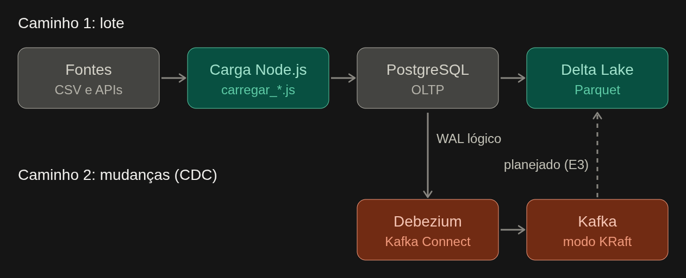

# Arquitetura e modelo de dados

Visão técnica da plataforma FarmaData: como o dado sai das fontes públicas,
passa pelo PostgreSQL (OLTP) e chega à camada analítica em formato aberto.
Decisões e alternativas estão nos ADRs (`docs/adr/`); aqui está o **como é**.

## 1. Visão geral



| Camada | Tecnologia | Papel |
|---|---|---|
| Fontes | SNGPC/Anvisa, DATASUS (CID-10), IBGE/SIDRA, INMET | Dados abertos, publicados em arquivos ou APIs |
| OLTP | PostgreSQL 16 | Fonte transacional normalizada, insert-only (ADR-001) |
| Ingestão em lote | Node.js 20 (`scripts/carregar_*.js`) | Download, validação e carga idempotente |
| Captura de mudanças | Debezium 2.7 + Kafka 3.8 (KRaft) | Eventos `c/u/d` do WAL da tabela de fatos |
| Analítico | Delta Lake sobre Parquet (`deltalake`, `pyarrow`) | Tabela achatada, particionada, em formato aberto |
| Consulta analítica | DuckDB (`delta_scan`) | Leitura por motor diferente do escritor |

## 2. Serviços (Docker Compose)

| Serviço | Imagem | Arquivo | Função |
|---|---|---|---|
| `db` | `postgres:16-alpine` | `docker-compose.yml` | OLTP; porta do host 5433 |
| `carga` | `node:20-slim` | `docker-compose.yml` | Roda os scripts de carga em lote |
| `kafka` | `apache/kafka:3.8.0` | `docker-compose.cdc.yml` | Broker single-node, modo KRaft |
| `connect` | `quay.io/debezium/connect:2.7` | `docker-compose.cdc.yml` | Kafka Connect com o conector Postgres |
| `lakehouse` | Python | `docker-compose.yml` | Exporta, compacta e valida o Delta |

O CDC é um *override*: o ambiente normal fica leve e a stack pesada só sobe quando necessário
(`docker compose -f docker-compose.yml -f docker-compose.cdc.yml up -d db kafka connect`).

## 3. Caminho 1 — ingestão em lote

1. **Download com cache** em `tmp/` e leitura em stream do CSV.
2. **Resolução de dimensões** (`municipio`, `medicamento`) com inserção sem duplicar.
3. **Carga de um arquivo mensal numa única transação:** `DELETE` das linhas do `arquivo_origem` → `COPY` → upsert em `carga_arquivo`. Falha = `ROLLBACK`.
4. **Controle:** `carga_arquivo` registra o que foi carregado; arquivo já presente dá `[SKIP]`. Um advisory lock impede duas cargas simultâneas.
5. **Índices:** removidos e recriados apenas quando há 3 ou mais arquivos pendentes; o índice `idx_venda_arquivo_origem` torna o `DELETE` barato.
6. **Linhas rejeitadas** são contadas por motivo (ex.: `sem_principio_ativo`, `quantidade_invalida`).

Reexecução, flags e evidência: seção de ingestão do `README.md` e `docs/evidencias/idempotencia.txt`.

## 4. Caminho 2 — captura de mudanças (CDC)

| Parâmetro | Valor | Motivo |
|---|---|---|
| Tabela capturada | `public.venda_medicamento` | Tabela de fatos |
| Plugin / slot / publicação | `pgoutput` / `farmadata_slot` / `farmadata_pub` | Decodificação lógica nativa |
| `REPLICA IDENTITY` | `FULL` | `before` traz a linha inteira em UPDATE/DELETE |
| `snapshot.mode` | `no_data` | O estado inicial já veio pelo lote |
| `decimal.handling.mode` | `string` | `NUMERIC` seria base64 por padrão |
| Tópico | `farmadata.public.venda_medicamento` | Prefixo `farmadata` + schema + tabela |

Evento: `op` (`c`, `u`, `d`), `before`, `after`, `source.lsn`, `ts_ms`.
**Destino atual:** o tópico Kafka. O consumidor que aplica os eventos no Delta está planejado para a E3.
**Atenção:** o slot retém WAL enquanto o conector está parado; recargas mensais com o conector ativo geram milhões de eventos.

## 5. Camada analítica

Caminho: `data/lakehouse/delta/venda_medicamento/` (`_delta_log/` + Parquet).

| Aspecto | Escolha |
|---|---|
| Modelo | Achatado: fato + atributos de dimensão (sem joins na leitura) |
| Partição | `ano`, `mes` |
| Ordenação interna | `sigla_uf`, `id_medicamento` |
| Codec / row group | ZSTD nível 3 / 500 mil linhas |
| Tamanho-alvo de arquivo | 128 MB (`compactar_delta.py`) |
| Idempotência | `overwrite` restrito à partição (`predicate = ano/mes`) |

Colunas do Delta: `id_venda`, `data_venda`, `ano`, `mes`, `trimestre`, `id_municipio`, `nome_municipio`,
`sigla_uf`, `regiao`, `id_medicamento`, `principio_ativo`, `tipo_receituario`, `quantidade_vendida`,
`unidade_medida`, `codigo_cid10`, `sexo_paciente`, `idade_paciente`, `unidade_idade`,
`eh_antimicrobiano`, `arquivo_origem`.

Detalhes e justificativas: `docs/CAMADA_ANALITICA.md`.

## 6. Modelo de dados (PostgreSQL)

### 6.1 Relacionamentos

```
unidade_federativa ──► municipio ───────────────┐
periodo ────────────────────────────────────────┤
medicamento ────────────────────────────────────┤
conselho_profissional ──────────────────────────┤──► venda_medicamento
tipo_receituario / unidade_medida / unidade_idade ┤
cid10 ──────────────────────────────────────────┘

municipio ──► ibge_populacao_municipio (id_municipio, ano)
municipio ──► ibge_populacao_faixa_etaria_municipio (id_municipio, ano, faixa_etaria)
unidade_federativa + periodo ──► clima_mensal_uf (sigla_uf, id_periodo)
carga_arquivo (controle de carga, sem FK)
```

### 6.2 Dicionário de dados

Gerado de `information_schema` e `pg_constraint` em 20/10/2026.

#### Dimensões

**`unidade_federativa`** — 27 UFs (valores fixos, `01_geografia_uf.sql`). PK `sigla`; UNIQUE `codigo_ibge`.

| Coluna | Tipo | Nulo | Descrição |
|---|---|---|---|
| `sigla` | char | não | Sigla da UF |
| `codigo_ibge` | integer | não | Código IBGE da UF |
| `nome` | varchar | não | Nome da UF |
| `regiao` | varchar | não | Região do país |

**`municipio`** — extraído dos CSVs do SNGPC. PK `id_municipio`; UNIQUE `(nome_municipio, sigla_uf)`; FK `sigla_uf` → `unidade_federativa` (ON UPDATE CASCADE).

| Coluna | Tipo | Nulo | Descrição |
|---|---|---|---|
| `id_municipio` | integer | não | Chave |
| `nome_municipio` | varchar | não | Nome como vem da Anvisa |
| `sigla_uf` | char | não | UF |
| `codigo_ibge` | integer | sim | Preenchido pelo carregador do IBGE; nulo quando a grafia diverge |

**`periodo`** — 12 meses do recorte (`03_tempo_periodo.sql`). PK `id_periodo` (`AAAAMM`); UNIQUE `(ano, mes)`.

| Coluna | Tipo | Nulo | Descrição |
|---|---|---|---|
| `id_periodo` | integer | não | Chave no formato `AAAAMM` |
| `ano`, `mes` | integer | não | Ano e mês |
| `nome_mes` | varchar | não | Nome do mês |
| `trimestre`, `semestre` | integer | não | Agrupamentos de tempo |
| `data_inicio`, `data_fim` | date | não | Limites do mês |

**`medicamento`** — extraído do SNGPC. PK `id_medicamento`; UNIQUE `(principio_ativo, descricao_apresentacao)`.

| Coluna | Tipo | Nulo | Descrição |
|---|---|---|---|
| `id_medicamento` | bigint | não | Chave |
| `principio_ativo` | text | não | Princípio ativo |
| `descricao_apresentacao` | text | não | Apresentação |

**`cid10`** — catálogo DATASUS. PK `codigo`.

| Coluna | Tipo | Nulo | Descrição |
|---|---|---|---|
| `codigo` | varchar | não | Código CID-10 |
| `descricao` | text | não | Descrição completa |
| `descricao_abreviada` | varchar | sim | Descrição curta |
| `categoria` | varchar | sim | Categoria (indexada) |
| `restricao_sexo`, `causa_obito` | char | sim | Campos do catálogo DATASUS |

**Listas fixas da Anvisa** (`06_prescritor_listas.sql`):

| Tabela | Colunas | Chave |
|---|---|---|
| `conselho_profissional` | `id_conselho` smallint, `sigla`, `descricao` | PK `id_conselho`; UNIQUE `sigla` |
| `tipo_receituario` | `id_tipo_receituario` smallint, `codigo`, `descricao` | PK `id_tipo_receituario`; UNIQUE `codigo` |
| `unidade_medida` | `id_unidade_medida` smallint, `descricao` | PK `id_unidade_medida`; UNIQUE `descricao` |
| `unidade_idade` | `id_unidade_idade` smallint, `descricao` | PK `id_unidade_idade`; UNIQUE `descricao` |

#### Fato

**`venda_medicamento`** — uma linha por registro do CSV agregado do SNGPC. PK `id_venda`; FKs para período, município, medicamento, conselho, tipo de receituário, unidades e CID-10.

| Coluna | Tipo | Nulo | Descrição |
|---|---|---|---|
| `id_venda` | bigint | não | Chave sequencial. **Não é estável entre recargas**: `DELETE` + `COPY` gera ids novos |
| `id_periodo` | integer | não | FK `periodo` |
| `data_venda` | date | não | Data (o carregador grava o dia 1 do mês) |
| `id_municipio` | integer | não | FK `municipio` |
| `id_medicamento` | bigint | não | FK `medicamento` |
| `id_conselho` | smallint | sim | FK `conselho_profissional` |
| `id_tipo_receituario` | smallint | sim | FK `tipo_receituario` |
| `quantidade_vendida` | numeric | não | Quantidade; unidades heterogêneas |
| `id_unidade_medida` | smallint | sim | FK `unidade_medida` |
| `codigo_cid10` | varchar | sim | FK `cid10` |
| `sexo_paciente` | char | sim | Sexo do paciente |
| `idade_paciente` | smallint | sim | Idade normalizada em anos |
| `id_unidade_idade` | smallint | sim | FK `unidade_idade` |
| `eh_antimicrobiano` | boolean | não | Heurística do carregador |
| `numero_notificacao` | varchar | sim | Não vem do CSV agregado; só a demo do CDC o preenche |
| `arquivo_origem` | varchar | sim | Arquivo mensal de origem; **chave de idempotência do lote** |

#### Bases complementares e controle

| Tabela | Colunas | Chave / FK | Origem |
|---|---|---|---|
| `ibge_populacao_municipio` | `id_municipio`, `ano`, `populacao` | PK `(id_municipio, ano)`; FK `municipio` | IBGE/SIDRA, agregado 6579 |
| `ibge_populacao_faixa_etaria_municipio` | `id_municipio`, `ano`, `faixa_etaria` text, `populacao` | PK `(id_municipio, ano, faixa_etaria)`; FK `municipio` | IBGE/SIDRA, agregado 9514 (Censo 2022) |
| `clima_mensal_uf` | `sigla_uf`, `id_periodo`, `temp_media_c`, `precipitacao_media_mm` (ambas anuláveis), `qtd_estacoes` smallint | PK `(sigla_uf, id_periodo)`; FKs `unidade_federativa`, `periodo` | INMET, dados históricos por estação |
| `carga_arquivo` | `arquivo` text, `linhas_lidas`, `linhas_inseridas`, `linhas_rejeitadas` bigint, `motivos_rejeicao` jsonb, `carregado_em` timestamptz | PK `arquivo` | Criada pelo `carregar_sngpc.js` |

### 6.3 Índices da tabela de fatos

| Índice | Colunas | Observação |
|---|---|---|
| `venda_medicamento_pkey` | `id_venda` | PK |
| `idx_venda_arquivo_origem` | `arquivo_origem` | Torna o `DELETE` da recarga barato; nunca é removido |
| `idx_venda_periodo_municipio` | `id_periodo, id_municipio` | Consultas por tempo e local |
| `idx_venda_municipio_periodo` | `id_municipio, id_periodo` | Consultas por local e tempo |
| `idx_venda_medicamento_periodo` | `id_medicamento, id_periodo` | Consultas por medicamento |
| `idx_venda_antimicrobiano` | `id_periodo, id_municipio` onde `eh_antimicrobiano` | Índice parcial |

Os quatro índices de consulta são os que o carregador remove e recria numa carga com 3 ou mais arquivos pendentes.
Não há `UNIQUE` na tabela de fatos: a idempotência é por arquivo, não por linha.

### 6.4 Preenchimento real ( ~6mi linhas)

| Coluna | Preenchidas | Leitura |
|---|---|---|
| `idade_paciente` | 4.593.047 (74,8%) | Usável para faixas etárias |
| `codigo_cid10` | 28.857 (0,5%) | Muito esparsa: análises por CID-10 cobrem uma fração pequena |
| `id_tipo_receituario` | 0 | Não preenchida pelo carregador |
| `id_unidade_medida` | 0 | Não preenchida; somas misturam unidades |
| `id_unidade_idade` | 0 | Não preenchida; a idade já está em anos |

### 6.5 Volume 

68.264.756 linhas em 12 arquivos mensais; 5.088 municípios e 1.231 princípios ativos distintos.

## 7. Limitações conhecidas

- A idempotência do lote tem granularidade de arquivo mensal, não de linha. O `DELETE` de ~6 milhões de linhas gera *bloat*.
- A carga incremental detecta meses novos; um arquivo republicado com o mesmo nome só é recarregado com `FORCE=1`.
- Municípios com grafia divergente entre Anvisa e IBGE ficam sem `codigo_ibge`.
- `id_tipo_receituario`, `id_unidade_medida` e `id_unidade_idade` ficam nulos; consultas que dependem deles (por receituário, por unidade) não são possíveis com esta carga, e as somas de `quantidade_vendida` misturam unidades.
- As tabelas do IBGE têm série por `ano`: consultas que as juntam à tabela de fatos devem filtrar o ano, ou a soma se multiplica.
- Os eventos do CDC terminam no Kafka; a aplicação no Delta fica para a E3.
- Domínio insert-only: o CDC é demonstrado com `UPDATE`/`DELETE` sintéticos (`scripts/cdc/demo_cdc.js`).

