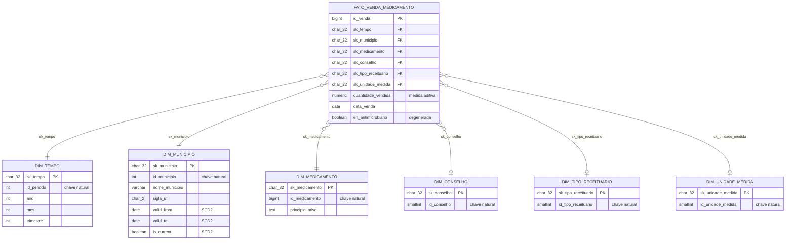

# Modelo Dimensional & Dimensão de Variação Lenta (SCD)

Issue: #24. Implementação em `sql/11_dimensional_dim_municipio_scd.sql` e
`sql/12_dimensional_fato_venda.sql`, sobre o OLTP normalizado da E1
([ADR-001](adr/ADR-001.md)).

## Declaração de granularidade

> **Uma linha em `fato_venda_medicamento` = uma dispensação (venda) de
> medicamento controlado ou antimicrobiano registrada no SNGPC, atribuída à
> versão do município (geografia/nome) vigente na data da venda.**

Mesmo grão de `venda_medicamento` (a fonte OLTP): nenhuma pré-agregação é
aplicada na fato. Isso evita a armadilha de dupla contagem — agregar por UF
e depois por município sobre a mesma fato não duplica linhas, porque não há
atributos multivalorados nem joins que causem *fan-out*; a única dimensão
versionada (`dim_municipio`) é resolvida por um join temporal que devolve
exatamente uma versão por venda.

## Diagrama ER (esquema estrela)



## Estratégia de chave substituta (surrogate key)

Todas as `sk_*` são **hash MD5 determinístico da chave natural** (builtin
`md5()`, sem extensão `pgcrypto`): `md5('<dimensão>|' || chave_natural)` para
dimensões imutáveis, e `md5('municipio|' || id_municipio || '|' ||
valid_from)` para `dim_municipio`, onde cada versão SCD2 tem sua própria
surrogate key. Determinístico = reprocessar a carga nunca gera uma chave
diferente para o mesmo dado, e a fato pode ser truncada/recarregada sem
depender de sequência ou estado externo. Trade-offs e alternativas
avaliadas em [ADR-004](adr/ADR-004.md).

Nas views `dim_conselho`, `dim_tipo_receituario` e `dim_unidade_medida` a
`sk_*` é calculada na própria view. Em `dim_tempo` e `dim_medicamento` ela é
uma coluna gerada armazenada (`CHAR(32) STORED`) em `periodo` e
`medicamento`, com o mesmo tipo da fato — evita o cast `CHAR(32)` → `TEXT`
no join (emenda ao ADR-004, issue #28; medição em
[docs/performance/](performance/RELATORIO_PERFORMANCE.md)).

## Dimensão de Variação Lenta: `dim_municipio` (SCD Tipo 2)

Município é a única dimensão sujeita a alteração do domínio público (IBGE
pode renomear, desmembrar ou alterar os limites de um município). As demais
dimensões vêm de publicações oficiais imutáveis (ADR-001) e não precisam de
versionamento.

- `valid_from` / `valid_to`: intervalo de vigência da versão (`valid_to
  NULL` = vigente).
- `is_current`: flag da versão corrente; índice único parcial garante só
  uma linha corrente por município.
- Função `aplicar_scd2_municipio(p_data_efetiva date)`: idempotente — abre a
  primeira versão (sentinela `1900-01-01`) para município novo; se os
  atributos versionados mudaram, fecha a versão corrente e abre uma nova,
  **sem apagar a anterior**.
- A fato resolve a versão correta via join temporal:
  `data_venda BETWEEN valid_from AND COALESCE(valid_to, 'infinity')`.
- Prova de versionamento sem perda de histórico: `make test-scd2`
  (`test_scd2_municipio.sh`), evidência em
  [`docs/evidencias/scd2.txt`](evidencias/scd2.txt).

## Como (re)carregar

```bash
make carga-sngpc MESES=202001   # popula municipio/venda_medicamento
make modelo-dimensional          # sincroniza dim_municipio (SCD2) e recarrega a fato
```

## Dicionário de dados

### `dim_tempo` (view sobre `periodo`)
| Coluna | Tipo | Descrição |
|---|---|---|
| `sk_tempo` | char(32) | Surrogate key (md5 de `id_periodo`) — coluna gerada armazenada em `periodo` (`GENERATED ALWAYS ... STORED`, emenda ao [ADR-004](adr/ADR-004.md), issue #28) |
| `id_periodo` | int | Chave natural, formato `AAAAMM` |
| `ano` | int | Ano |
| `mes` | int | Mês (1-12) |
| `nome_mes` | varchar | Nome do mês em português |
| `trimestre` | int | Trimestre (1-4) |
| `semestre` | int | Semestre (1-2) |
| `data_inicio` | date | Primeiro dia do mês |
| `data_fim` | date | Último dia do mês |

### `dim_municipio` (tabela real, SCD Tipo 2)
| Coluna | Tipo | Descrição |
|---|---|---|
| `sk_municipio` | char(32) PK | Surrogate key (md5 de `id_municipio` + `valid_from`) — uma por versão |
| `id_municipio` | int | Chave natural (FK lógica para `municipio`) |
| `nome_municipio` | varchar(150) | Nome do município nesta versão |
| `sigla_uf` | char(2) | UF nesta versão |
| `regiao` | varchar(20) | Região (Norte/Nordeste/...) nesta versão |
| `codigo_ibge` | int | Código IBGE nesta versão |
| `valid_from` | date | Início da vigência desta versão |
| `valid_to` | date | Fim da vigência (`NULL` = vigente) |
| `is_current` | boolean | `TRUE` para a versão vigente (única por município) |

### `dim_medicamento` (view sobre `medicamento`)
| Coluna | Tipo | Descrição |
|---|---|---|
| `sk_medicamento` | char(32) | Surrogate key (md5 de `id_medicamento`) — coluna gerada armazenada em `medicamento` (`GENERATED ALWAYS ... STORED`, emenda ao [ADR-004](adr/ADR-004.md), issue #28) |
| `id_medicamento` | bigint | Chave natural |
| `principio_ativo` | text | Princípio ativo |
| `descricao_apresentacao` | text | Apresentação (ex.: "Comprimido 10mg") |

### `dim_conselho` (view sobre `conselho_profissional`)
| Coluna | Tipo | Descrição |
|---|---|---|
| `sk_conselho` | char(32) | Surrogate key (md5 de `id_conselho`) |
| `id_conselho` | smallint | Chave natural |
| `sigla` | varchar(10) | Sigla do conselho (CRM, CRO, ...) |
| `descricao` | varchar(80) | Nome completo do conselho |

### `dim_tipo_receituario` (view sobre `tipo_receituario`)
| Coluna | Tipo | Descrição |
|---|---|---|
| `sk_tipo_receituario` | char(32) | Surrogate key (md5 de `id_tipo_receituario`) |
| `id_tipo_receituario` | smallint | Chave natural |
| `codigo` | varchar(5) | Código Anvisa (A, B1, B2, C1, D) |
| `descricao` | varchar(100) | Descrição do tipo de receituário |

### `dim_unidade_medida` (view sobre `unidade_medida`)
| Coluna | Tipo | Descrição |
|---|---|---|
| `sk_unidade_medida` | char(32) | Surrogate key (md5 de `id_unidade_medida`) |
| `id_unidade_medida` | smallint | Chave natural |
| `descricao` | varchar(30) | Unidade (Caixa, Frasco, Ampola, ...) |

### `fato_venda_medicamento`
| Coluna | Tipo | Descrição |
|---|---|---|
| `id_venda` | bigint PK | Chave natural da dispensação (origem: `venda_medicamento.id_venda`) |
| `sk_tempo` | char(32) FK | Surrogate key de `dim_tempo` |
| `sk_municipio` | char(32) FK | Surrogate key de `dim_municipio` (versão vigente na `data_venda`) |
| `sk_medicamento` | char(32) FK | Surrogate key de `dim_medicamento` |
| `sk_conselho` | char(32) FK | Surrogate key de `dim_conselho` (pode ser `NULL`) |
| `sk_tipo_receituario` | char(32) FK | Surrogate key de `dim_tipo_receituario` (pode ser `NULL`) |
| `sk_unidade_medida` | char(32) FK | Surrogate key de `dim_unidade_medida` (pode ser `NULL`) |
| `id_periodo`, `id_municipio`, `id_medicamento`, `id_conselho`, `id_tipo_receituario`, `id_unidade_medida` | — | Chaves naturais, mantidas para rastreabilidade até o OLTP |
| `data_venda` | date | Data da dispensação |
| `quantidade_vendida` | numeric(10,3) | **Medida aditiva** — soma livremente por qualquer dimensão |
| `codigo_cid10` | varchar(10) | CID-10 (somente antimicrobianos) |
| `sexo_paciente` | char(1) | Sexo do paciente (somente antimicrobianos) |
| `idade_paciente` | smallint | Idade do paciente (somente antimicrobianos) |
| `id_unidade_idade` | smallint | Unidade da idade: anos/meses (somente antimicrobianos) |
| `eh_antimicrobiano` | boolean | Flag degenerada — distingue o subconjunto antimicrobiano |
| `numero_notificacao` | varchar(30) | Atributo degenerado — número da notificação de receita |
| `arquivo_origem` | varchar(80) | Atributo degenerado — rastreabilidade do arquivo de carga |
