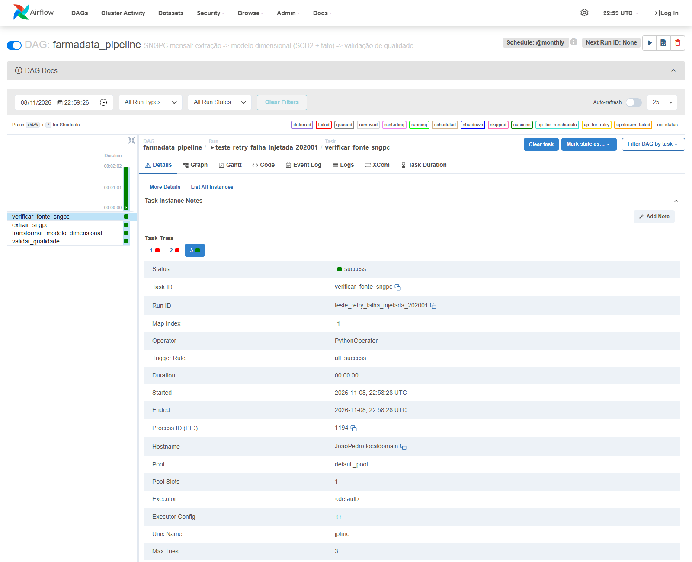

# Orquestração do pipeline — Apache Airflow

DAG: [`airflow/dags/farmadata_pipeline.py`](../../airflow/dags/farmadata_pipeline.py) · Airflow 2.10.5 · LocalExecutor

## 1. Grafo de dependências

```
verificar_fonte_sngpc ──► extrair_sngpc ──► transformar_modelo_dimensional ──► validar_qualidade
```

| Task | Operador | O que faz |
|---|---|---|
| `verificar_fonte_sngpc` | Python | Confirma que o CSV do mês existe: arquivo local em `FARMADATA_SNGPC_DIR` ou `HEAD` na Anvisa. Ponto de injeção de falha. |
| `extrair_sngpc` | Bash | `node scripts/carregar_sngpc.js` com `SNGPC_MESES=<mês do run>` e `SNGPC_FORCE=1`. Carga idempotente por arquivo (DELETE + COPY na mesma transação). |
| `transformar_modelo_dimensional` | Python | `aplicar_scd2_municipio()` + `carregar_fato_venda_medicamento()` (sql/11 e sql/12). |
| `validar_qualidade` | Python | Regras de qualidade do mês. Se qualquer uma falhar, a task falha (ver tabela abaixo). |

Um DAG run corresponde a um mês de referência, dado por `data_interval_start`. O agendamento é `@monthly`, entre `2020-01-01` e `2020-12-31` (ANO_RECORTE).

**Por que o grafo é linear e os runs não rodam em paralelo**
- Cada etapa consome o que a anterior gravou, então não há duas tasks independentes que pudessem rodar ao mesmo tempo.
- `max_active_runs=1`: a carga SNGPC usa advisory lock, e a fato é recarregada com `TRUNCATE + INSERT`. Dois meses em paralelo ficariam esperando o lock ou um apagaria a fato do outro. No backfill, os meses rodam em série (ver 4).
- `catchup=False`: o histórico só é reprocessado quando alguém pede, por backfill explícito. Ligar a DAG não dispara 12 runs.

**Regras de `validar_qualidade`**

| Regra | Pega o quê |
|---|---|
| arquivo do mês registrado em `carga_arquivo` | carga que não chegou a commitar |
| o arquivo do mês trouxe vendas | CSV vazio/truncado |
| fato do mês = vendas do mês | vendas perdidas no join temporal SCD2 |
| fato total = `venda_medicamento` total | fato desatualizada |
| toda venda está na versão SCD2 vigente na `data_venda` | join temporal errado |
| `quantidade_vendida > 0` | métrica inválida |
| no máximo 1 versão corrente por município | SCD2 corrompido |


## 2. Tolerância a falhas

```python
default_args = {
    "retries": 3,                              # >= 2; até 4 tentativas
    "retry_delay": timedelta(seconds=20),      # base do backoff
    "retry_exponential_backoff": True,         # ~20s, ~40s, ~80s (+ jitter do Airflow)
    "max_retry_delay": timedelta(minutes=10),  # teto
    "on_retry_callback": alerta_retry,
    "on_failure_callback": alerta_falha,
}
```

**Alerta:** os dois callbacks registram um JSON com nível (`RETRY`/`FALHA`), task, run, mês, tentativa, horário da próxima tentativa e erro. Esse JSON vai para o log da task (`[ALERTA RETRY]` / `[ALERTA FALHA]`) e para `$AIRFLOW_HOME/alertas_farmadata.jsonl`. Num ambiente de produção, é aqui que entraria o envio por e-mail ou Slack. Aqui o destino é um arquivo, para que cada disparo possa ser conferido.

**Injeção de falha:** a Airflow Variable `farmadata_falha_injetada` faz `verificar_fonte_sngpc` falhar de propósito nas N primeiras tentativas, simulando a fonte da Anvisa fora do ar:

```json
{"task_id": "verificar_fonte_sngpc", "falhas": 2, "mes": "202003"}
```

A chave `mes` é opcional e restringe a falha a um único mês. Para desligar a injeção, basta apagar a Variable.

## 3. Evidência — retry com recuperação (falha injetada)

Run `teste_retry_falha_injetada_202001` (mês 202001), com `falhas: 2`:

| Tentativa | Início (UTC) | Resultado | Próxima tentativa agendada | Espera |
|---|---|---|---|---|
| 1 | 22:56:31 | falha injetada → `UP_FOR_RETRY` + alerta | 22:57:10 | 39 s |
| 2 | 22:57:11 | falha injetada → `UP_FOR_RETRY` + alerta | 22:58:28 | 77 s |
| 3 | 22:58:28 | **sucesso**; downstream roda e o run termina `success` | — | — |

A espera praticamente dobra de uma tentativa para a outra (39 s → 77 s), como esperado do backoff exponencial. As tasks downstream só começaram depois do sucesso da tentativa 3.

```
[19:56:31] INFO - Starting attempt 1 of 4
AirflowException: [FALHA INJETADA] fonte SNGPC indisponível (simulação de HTTP 503) — tentativa 1/2 programada para falhar
[19:56:31] INFO - Marking task as UP_FOR_RETRY. ... task_id=verificar_fonte_sngpc, run_id=teste_retry_falha_injetada_202001
[19:56:31] WARNING - [ALERTA RETRY] {"nivel": "RETRY", ..., "tentativa": 1, "max_tentativas": 4, "proxima_tentativa_em": "2026-11-08T22:57:10+00:00", ...}
[19:57:11] INFO - Starting attempt 2 of 4
[19:57:11] INFO - Marking task as UP_FOR_RETRY. ...
[19:57:11] WARNING - [ALERTA RETRY] {..., "tentativa": 2, ..., "proxima_tentativa_em": "2026-11-08T22:58:28+00:00", ...}
[19:58:28] INFO - Starting attempt 3 of 4
[19:58:28] INFO - [FALHA INJETADA] tentativa 3 > 2 falhas programadas: seguindo normalmente
[19:58:28] INFO - Marking task as SUCCESS. ...
```

(Horários do log em UTC−3; na UI e nos alertas, em UTC.)

| | |
|---|---|
| Durante o retry (`up_for_retry`, log da 1ª falha + alerta) |  |
| Tentativas 1 e 2 em vermelho, 3 em verde |  |
| Gantt: intervalos crescentes entre tentativas, downstream só depois do sucesso |  |
| Detalhes da task instance |  |

Logs completos de cada tentativa: [`logs/retry_202001/`](logs/retry_202001/).

> Depois de coletadas as evidências, este run manual foi apagado do banco de metadados. Ele ocupava a data lógica `2020-02-01`, que o backfill precisava usar para o mês 202002. Os logs e os prints acima continuam valendo.

## 4. Evidência — backfill histórico (jan–jun/2020)

```bash
airflow dags backfill farmadata_pipeline -s 2020-01-01 -e 2020-06-01
```

Para mostrar que o retry também funciona dentro do backfill, a Variable foi configurada com `{"falhas": 1, "mes": "202003"}`.

- 6 runs `backfill__2020-0X-01`, todos `success` (saída: `finished run 6 of 6 | succeeded: 24 | failed: 0`, exit 0).
- **Em série:** cada mês só começa depois que o anterior termina (ver as colunas Start/End no print da lista de runs).
- **Retry dentro do backfill:** a tentativa 1 de `verificar_fonte_sngpc` em 202003 falhou. O backfill esperou cerca de 24 s sem adiantar abril. A tentativa 2 passou, e por isso esse run levou 29 s, contra 4–5 s dos demais.
- **Reprocessamento sem duplicar:** o mês 202001 já tinha sido carregado no teste da seção 3 e foi recarregado pelo backfill. O mês continua com 4 vendas, e a fato bate com `venda_medicamento` em todos os meses:

```
 id_periodo | vendas | fato |  qtd
     202001 |      4 |    4 | 69.000
     202002 |      4 |    4 | 73.000
     202003 |      4 |    4 | 77.000
     202004 |      5 |    5 | 85.000
     202005 |      5 |    5 | 90.000
     202006 |      5 |    5 | 95.000
```

| | |
|---|---|
| Grid: 6 runs de backfill concluídos |  |
| Lista de DAG runs (Run Type = backfill, em série) |  |
| Retry no mês 202003 dentro do backfill |  |
| Validação de qualidade de 202003 |  |

Arquivos de evidência:
- [`logs/backfill_cli.txt`](logs/backfill_cli.txt): saída completa da CLI do backfill.
- [`logs/backfill_202003/`](logs/backfill_202003/): logs por task e tentativa do mês com retry.
- [`logs/estado_pos_backfill.txt`](logs/estado_pos_backfill.txt): `list-runs`, tentativas por task instance (horários em UTC−3), `carga_arquivo` e contagens venda × fato.
- [`logs/alertas_farmadata.jsonl`](logs/alertas_farmadata.jsonl): todos os alertas emitidos.

## 5. Evidência: falha definitiva, com retries esgotados e alerta de falha

Este caso não usa injeção. O run `teste_falha_definitiva_202007` pede o mês 202007, cujo CSV não existe na fonte. O resultado são 4 tentativas, todas falhando:

| Tentativa | Alerta | Próxima tentativa | Espera |
|---|---|---|---|
| 1 | `RETRY` 23:03:51 | 23:04:21 | 30 s |
| 2 | `RETRY` 23:04:22 | 23:05:06 | 44 s |
| 3 | `RETRY` 23:05:06 | 23:07:39 | 153 s |
| 4 | **`FALHA`** 23:07:40 | — | — |

Depois disso, `extrair_sngpc`, `transformar_modelo_dimensional` e `validar_qualidade` ficaram `upstream_failed`. Nenhuma carga parcial foi feita, e o banco seguiu com os 6 meses do backfill.

As esperas (30 s, 44 s e 153 s) variam porque o Airflow sorteia cada uma dentro de uma faixa que dobra a cada tentativa: [20 s, 40 s), [40 s, 80 s), [80 s, 160 s). Por isso nem sempre uma espera é exatamente o dobro da anterior.

| | |
|---|---|
| 4 tentativas em vermelho; log da última com `[ALERTA FALHA]` |  |
| Gantt das 4 tentativas |  |

Logs: [`logs/falha_definitiva_202007/`](logs/falha_definitiva_202007/).

## 6. Como reproduzir

### Com Docker (padrão do projeto)

```bash
make airflow-up                                   # db + Airflow em http://localhost:8080 (admin/admin)
make airflow-falha FALHAS=2                       # liga a injeção de falha
make airflow-sem-falha                            # desliga
make airflow-backfill INICIO=2020-01-01 FIM=2020-06-01
```

Por padrão, o compose aponta para o banco `farmadata` e baixa os CSVs reais da Anvisa. Para a demonstração rápida com fixtures, defina `FARMADATA_SNGPC_DIR=/opt/farmadata/scripts/fixtures/orquestracao`, sempre num banco de testes, nunca no `farmadata` com dados reais.

### Sem Docker (Linux/WSL, sem root): ambiente usado nas evidências

```bash
bash airflow/local/airflow_local.sh setup   # venv (uv) + Airflow + PostgreSQL 16 embarcado (pgserver) + schema sql/01..12
bash airflow/local/airflow_local.sh start   # scheduler + webserver em :8080
eval "$(bash airflow/local/airflow_local.sh env)"
airflow dags backfill farmadata_pipeline -s 2020-01-01 -e 2020-06-01
```

## 7. Escopo da evidência

- As execuções usaram as fixtures [`scripts/fixtures/orquestracao/`](../../scripts/fixtures/orquestracao/) (de 4 a 5 dispensações por mês), não os CSVs completos da Anvisa (centenas de MB por mês). O código executado é o mesmo que roda com os dados reais. Muda apenas `FARMADATA_SNGPC_DIR`.
- As evidências foram geradas com o script local (WSL, Airflow 2.10.5 + PostgreSQL 16), porque a máquina não tinha Docker. O `docker-compose.airflow.yml` e o `airflow/Dockerfile` seguem a mesma configuração, mas não foram executados neste ambiente.
