# Orquestração do pipeline — Apache Airflow

DAG: [`airflow/dags/farmadata_pipeline.py`](https://github.com/gabrielfreitass1/FarmaData/blob/main/airflow/dags/farmadata_pipeline.py) · Airflow 2.10.5 · LocalExecutor · Docker ([`docker-compose.airflow.yml`](https://github.com/gabrielfreitass1/FarmaData/blob/main/docker-compose.airflow.yml))

Todas as evidências desta página foram geradas no Docker (container `farmadata_airflow`), em 08/11/2026.

## 1. Grafo de dependências e agendamento

```
verificar_fonte_sngpc ──► extrair_sngpc ──► transformar_modelo_dimensional ──► validar_qualidade
```

| Task | Operador | O que faz |
|---|---|---|
| `verificar_fonte_sngpc` | Python | Confirma que o CSV do mês existe: arquivo local em `FARMADATA_SNGPC_DIR` ou `HEAD` na Anvisa. Ponto de injeção de falha. |
| `extrair_sngpc` | Bash | `node scripts/carregar_sngpc.js` com `SNGPC_MESES=<mês do run>` e `SNGPC_FORCE=1`. Carga idempotente por arquivo (DELETE + COPY na mesma transação). |
| `transformar_modelo_dimensional` | Python | `aplicar_scd2_municipio()` + `carregar_fato_venda_medicamento()` (sql/11 e sql/12). |
| `validar_qualidade` | Python | Regras de qualidade do mês. Se qualquer uma falhar, a task falha (ver tabela abaixo). |

**Agendamento:** `@monthly`, começando em `2020-01-01`, sem data final. Cada run processa o mês dado por `data_interval_start`, então no dia 1º o scheduler processa o mês que acabou de fechar. A UI mostra a próxima execução agendada (`Next Run ID: 2026-10-01`, que processa outubro/2026).

**Por que o grafo é linear e os runs não rodam em paralelo**
- Cada etapa consome o que a anterior gravou, então não há duas tasks independentes que pudessem rodar ao mesmo tempo.
- `max_active_runs=1`: a carga SNGPC usa advisory lock, e a fato é recarregada com `TRUNCATE + INSERT`. Dois meses em paralelo ficariam esperando o lock ou um apagaria a fato do outro. No backfill, os meses rodam em série (ver 4).
- `catchup=False`: ligar a DAG roda só o mês mais recente. O histórico só é reprocessado por backfill explícito.

**Regras de `validar_qualidade`**

| Regra | Pega o quê |
|---|---|
| arquivo do mês registrado em `carga_arquivo` | carga que não chegou a commitar |
| o arquivo do mês trouxe vendas | CSV vazio/truncado |
| fato do mês = vendas do mês | vendas perdidas no join temporal SCD2 |
| fato total = `venda_medicamento` total | fato desatualizada |
| toda venda está na versão SCD2 vigente na `data_venda` | join temporal errado |
| `quantidade_vendida > 0` | métrica inválida |
| no máximo 1 versão corrente por município | SCD2 corrompido |

| | |
|---|---|
| Grafo | 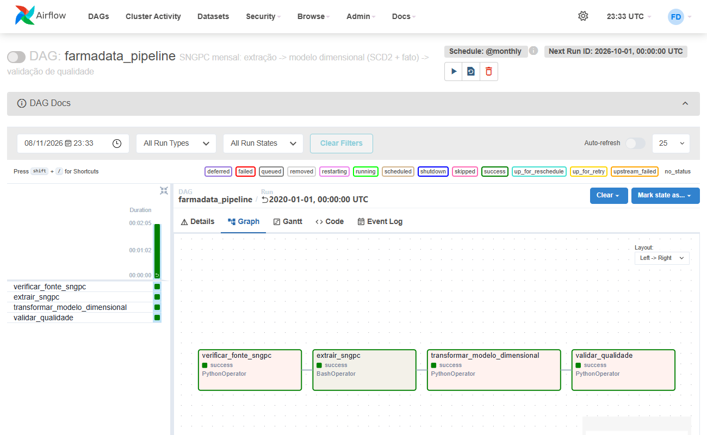 |
| Agendamento ativo (`@monthly`, próxima execução) | 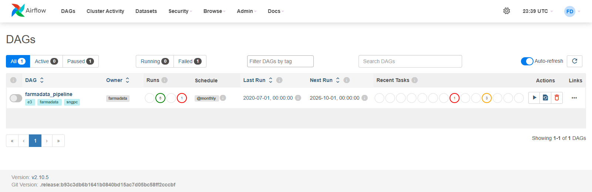 |

## 2. Tolerância a falhas

```python
default_args = {
    "retries": 3,                              # >= 2; até 4 tentativas
    "retry_delay": timedelta(seconds=20),      # base do backoff
    "retry_exponential_backoff": True,         # ~20s, ~40s, ~80s (+ jitter do Airflow)
    "max_retry_delay": timedelta(minutes=10),  # teto
    "on_retry_callback": alerta_retry,
    "on_failure_callback": alerta_falha,
}
```

**Alerta:** os dois callbacks registram um JSON com nível (`RETRY`/`FALHA`), task, run, mês, tentativa, horário da próxima tentativa e erro. Esse JSON vai para o log da task (`[ALERTA RETRY]` / `[ALERTA FALHA]`) e para `$AIRFLOW_HOME/alertas_farmadata.jsonl`. Num ambiente de produção, é aqui que entraria o envio por e-mail ou Slack. Aqui o destino é um arquivo, para que cada disparo possa ser conferido: [`logs/alertas_farmadata.jsonl`](logs/alertas_farmadata.jsonl).

**Injeção de falha:** a Airflow Variable `farmadata_falha_injetada` faz `verificar_fonte_sngpc` falhar de propósito nas N primeiras tentativas, simulando a fonte da Anvisa fora do ar:

```json
{"task_id": "verificar_fonte_sngpc", "falhas": 2, "mes": "202001"}
```

A chave `mes` é opcional e restringe a falha a um único mês. Para desligar a injeção, basta apagar a Variable.

As esperas não dobram exatamente porque o Airflow sorteia cada uma dentro de uma faixa que dobra a cada tentativa: [20 s, 40 s), [40 s, 80 s), [80 s, 160 s).

## 3. Evidência — retry com recuperação (falha injetada)

`airflow dags backfill farmadata_pipeline -s 2020-01-01 -e 2020-01-01`, com `{"falhas": 2, "mes": "202001"}`:

| Tentativa | Início (UTC) | Resultado | Próxima tentativa agendada | Espera |
|---|---|---|---|---|
| 1 | 23:30:31 | falha injetada → `UP_FOR_RETRY` + alerta | 23:31:10 | 39 s |
| 2 | 23:31:11 | falha injetada → `UP_FOR_RETRY` + alerta | 23:32:30 | 79 s |
| 3 | 23:32:30 | **sucesso**; downstream roda e o run termina `success` | — | — |

A espera praticamente dobra (39 s → 79 s), como esperado do backoff exponencial. As tasks downstream só começaram depois do sucesso da tentativa 3.

```
[23:30:31] INFO - Starting attempt 1 of 4
AirflowException: [FALHA INJETADA] fonte SNGPC indisponível (simulação de HTTP 503) — tentativa 1/2 programada para falhar
[23:30:31] INFO - Marking task as UP_FOR_RETRY. ... task_id=verificar_fonte_sngpc, run_id=backfill__2020-01-01T00:00:00+00:00
[23:30:31] WARNING - [ALERTA RETRY] {"nivel": "RETRY", ..., "tentativa": 1, "max_tentativas": 4, "proxima_tentativa_em": "2026-11-08T23:31:10+00:00", ...}
[23:31:11] INFO - Starting attempt 2 of 4
[23:31:11] INFO - Marking task as UP_FOR_RETRY. ...
[23:31:11] WARNING - [ALERTA RETRY] {..., "tentativa": 2, ..., "proxima_tentativa_em": "2026-11-08T23:32:30+00:00", ...}
[23:32:30] INFO - Starting attempt 3 of 4
[23:32:30] INFO - [FALHA INJETADA] tentativa 3 > 2 falhas programadas: seguindo normalmente
[23:32:30] INFO - Marking task as SUCCESS. ...
```

| | |
|---|---|
| Durante o retry: tentativas 1 e 2 falhadas, task `up_for_retry`, log com `[ALERTA RETRY]` | 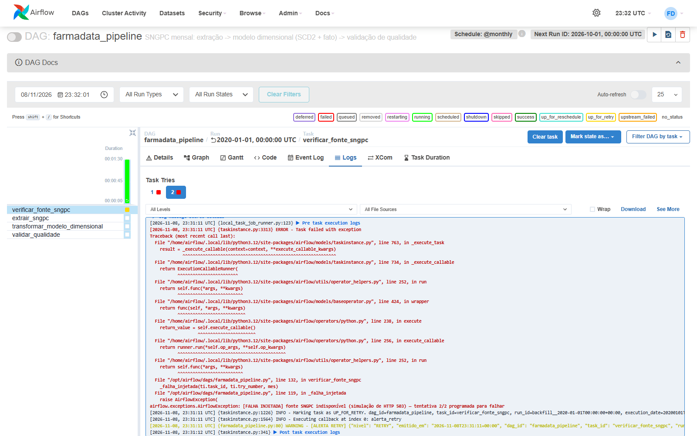 |
| Recuperação: tentativas 1 e 2 em vermelho, 3 em verde | 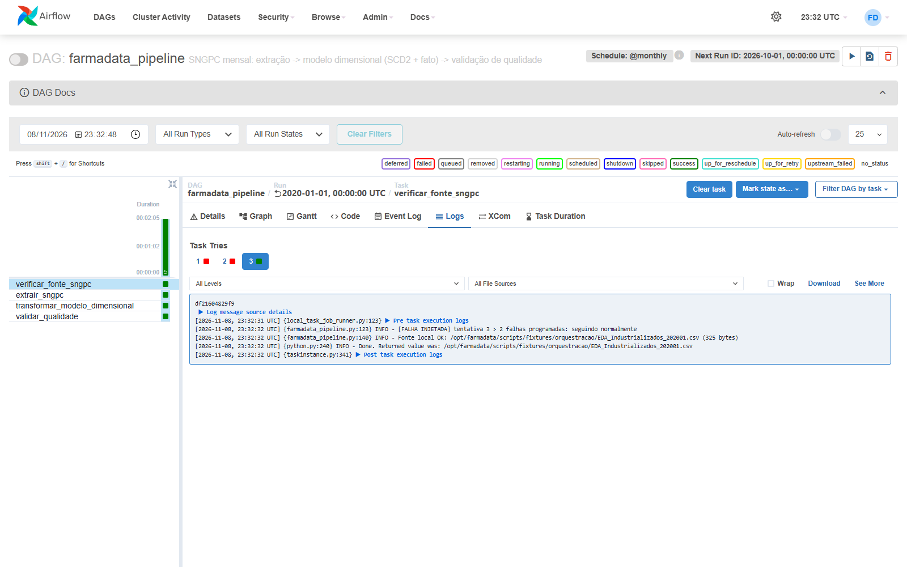 |
| Gantt: intervalos crescentes entre tentativas, downstream só depois do sucesso | 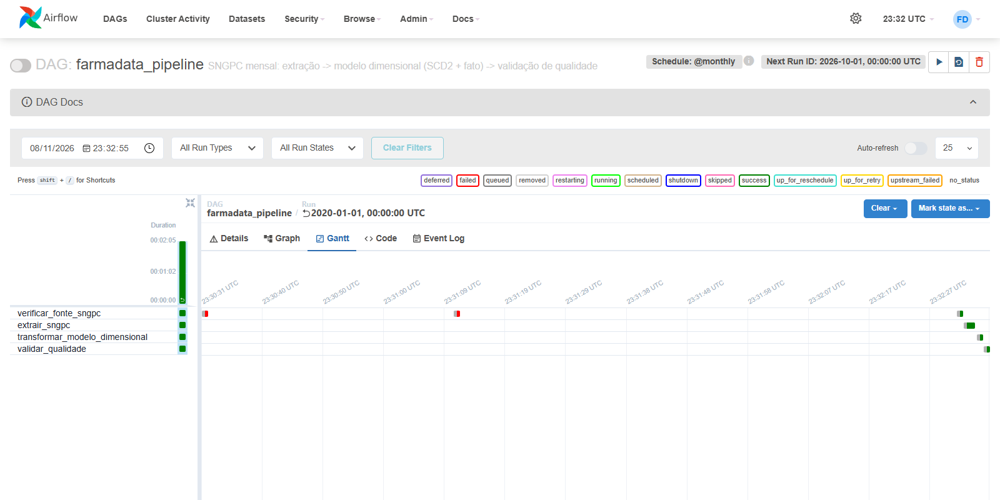 |

Logs: [`logs/retry_202001_cli.txt`](logs/retry_202001_cli.txt) (saída da CLI) e [`logs/retry_202001/`](https://github.com/gabrielfreitass1/FarmaData/tree/main/docs/orchestration/logs/retry_202001) (cada tentativa).

## 4. Evidência — backfill histórico (jan–jun/2020)

```bash
airflow dags backfill farmadata_pipeline -s 2020-01-01 -e 2020-06-01 --reset-dagruns -y
```

- **Reprocessamento:** janeiro já tinha sido carregado no teste da seção 3, e o `--reset-dagruns` o reprocessou junto com os demais. Por isso o run de janeiro aparece com a tentativa 4 em `verificar_fonte_sngpc`, depois das 3 da seção 3.
- **Retry dentro do backfill:** a Variable foi configurada com `{"falhas": 1, "mes": "202003"}`. A tentativa 1 de março falhou. O backfill esperou 24 s sem adiantar abril, e a tentativa 2 passou. Por isso esse run levou 30 s, contra 4–5 s dos demais.
- **Resultado:** 6 runs `success` (`finished run 6 of 6 | succeeded: 24 | failed: 0`, exit 0), em série: cada mês começa só depois que o anterior termina.
- **Sem duplicação:** janeiro foi carregado 2 vezes e continua com 4 vendas. A fato bate com `venda_medicamento` em todos os meses:

```
 id_periodo | vendas | fato |  qtd
     202001 |      4 |    4 | 69.000
     202002 |      4 |    4 | 73.000
     202003 |      4 |    4 | 77.000
     202004 |      5 |    5 | 85.000
     202005 |      5 |    5 | 90.000
     202006 |      5 |    5 | 95.000
```

| | |
|---|---|
| Grid: runs de backfill (jan–jun em verde; jul é o teste da seção 5) | 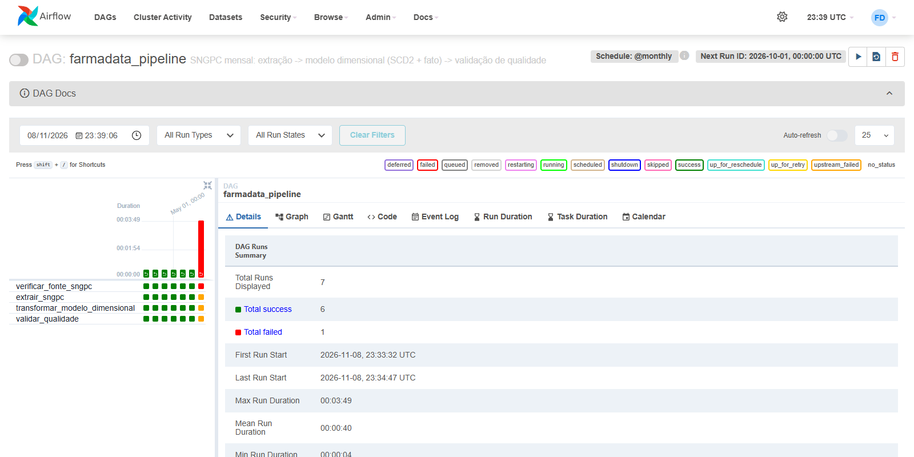 |
| Lista de DAG runs: Run Type = backfill, um mês depois do outro | 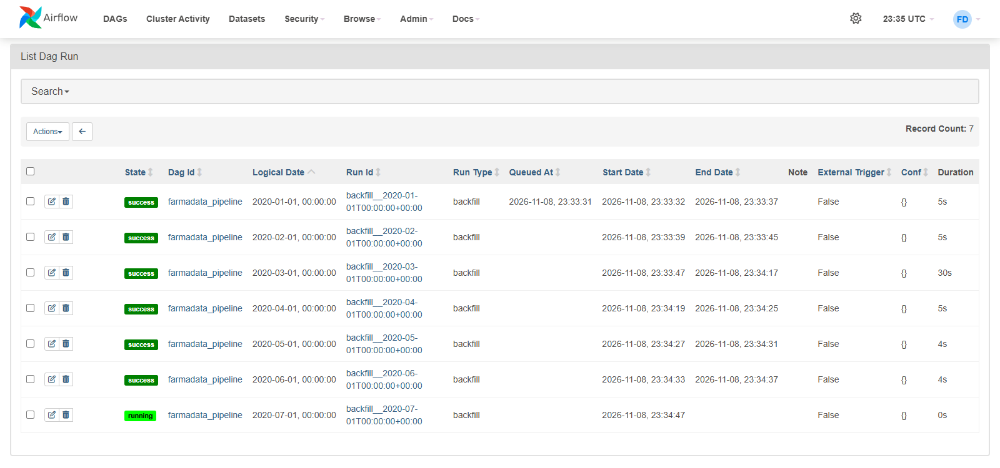 |
| Retry no mês 202003 dentro do backfill | 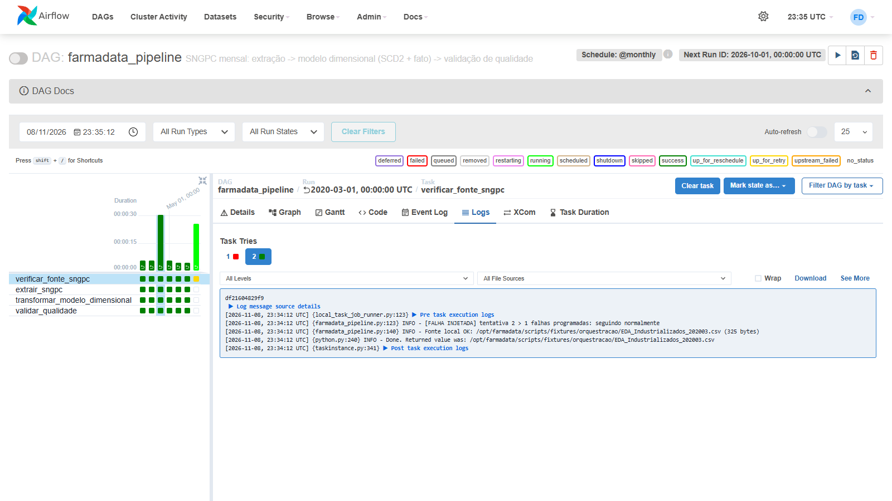 |
| Validação de qualidade de 202003 | 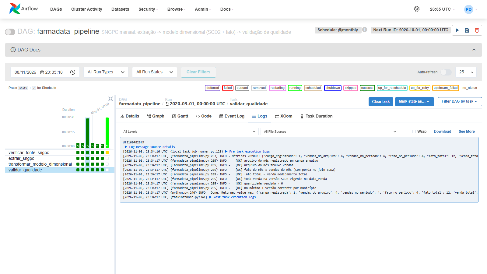 |

Arquivos:
- [`logs/backfill_cli.txt`](logs/backfill_cli.txt): saída completa da CLI.
- [`logs/backfill_202003/`](https://github.com/gabrielfreitass1/FarmaData/tree/main/docs/orchestration/logs/backfill_202003): logs por task e tentativa do mês com retry.
- [`logs/estado_pos_backfill.txt`](logs/estado_pos_backfill.txt): `list-runs`, tentativas por task instance, `carga_arquivo`, contagens venda × fato e a confirmação de que o banco `farmadata` não foi tocado.

## 5. Evidência — falha definitiva (retries esgotados + alerta de falha)

Este caso não usa injeção. `airflow dags backfill ... -s 2020-07-01 -e 2020-07-01` pede o mês 202007, cujo CSV não existe na fonte:

| Tentativa | Alerta (UTC) | Próxima tentativa | Espera |
|---|---|---|---|
| 1 | `RETRY` 23:34:48 | 23:35:14 | 26 s |
| 2 | `RETRY` 23:35:15 | 23:36:06 | 51 s |
| 3 | `RETRY` 23:36:07 | 23:38:35 | 148 s |
| 4 | **`FALHA`** 23:38:36 | — | — |

Depois disso, `extrair_sngpc`, `transformar_modelo_dimensional` e `validar_qualidade` ficaram `upstream_failed`. Nenhuma carga parcial foi feita, e o backfill terminou com `BackfillUnfinished: Some task instances failed` (exit 1).

| | |
|---|---|
| 4 tentativas em vermelho; log da última com `[ALERTA FALHA]` | 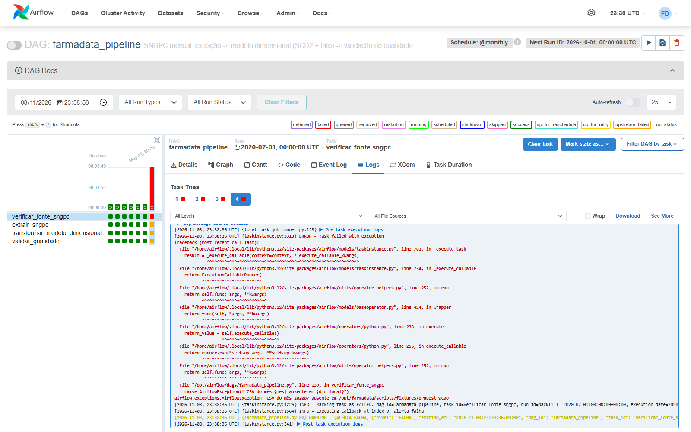 |
| Gantt das 4 tentativas | 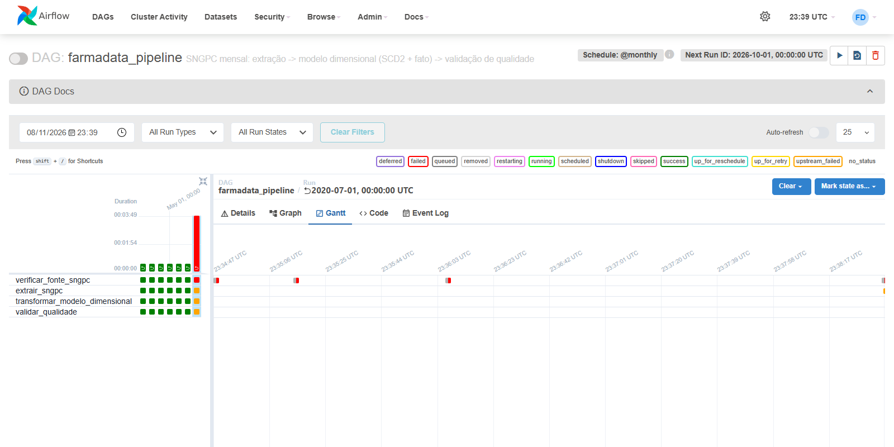 |

Logs: [`logs/falha_definitiva_202007_cli.txt`](logs/falha_definitiva_202007_cli.txt) e [`logs/falha_definitiva_202007/`](https://github.com/gabrielfreitass1/FarmaData/tree/main/docs/orchestration/logs/falha_definitiva_202007).

## 6. Como reproduzir (Docker)

```bash
make airflow-demo     # cria o banco de testes farmadata_orquestracao e sobe db + Airflow com as fixtures
```

A UI fica em http://localhost:8080, com usuário `admin` e senha `admin` (credenciais de desenvolvimento). Os testes desta página, na ordem:

```bash
make airflow-falha FALHAS=2                                   # injeção (para restringir a um mês: Variable com "mes")
make airflow-backfill INICIO=2020-01-01 FIM=2020-01-01         # retry com recuperação
make airflow-sem-falha
make airflow-backfill INICIO=2020-01-01 FIM=2020-06-01 EXTRA="--reset-dagruns -y"   # backfill histórico, reprocessando jan
make airflow-backfill INICIO=2020-07-01 FIM=2020-07-01         # falha definitiva (sem CSV de julho)
```

Sem `make`, os comandos equivalentes são:

```bash
bash airflow/preparar_banco_demo.sh
MSYS_NO_PATHCONV=1 FARMADATA_DB=farmadata_orquestracao FARMADATA_SNGPC_DIR=/opt/farmadata/scripts/fixtures/orquestracao docker compose -f docker-compose.yml -f docker-compose.airflow.yml up -d --build db airflow
docker compose -f docker-compose.yml -f docker-compose.airflow.yml exec airflow airflow dags backfill farmadata_pipeline -s 2020-01-01 -e 2020-06-01
```

No Windows com Git Bash, o `MSYS_NO_PATHCONV=1` é necessário. Sem ele, o Git Bash reescreve `/opt/...` como `C:/Program Files/Git/opt/...`.

Para usar os dados reais, rode `make airflow-up`. Ele aponta para o banco `farmadata` e baixa os CSVs da Anvisa para `tmp/`.

Há também um script sem Docker, para Linux/WSL sem root: [`airflow/local/airflow_local.sh`](https://github.com/gabrielfreitass1/FarmaData/blob/main/airflow/local/airflow_local.sh).

## 7. Escopo da evidência

- As execuções usaram as fixtures [`scripts/fixtures/orquestracao/`](https://github.com/gabrielfreitass1/FarmaData/tree/main/scripts/fixtures/orquestracao) (de 4 a 5 dispensações por mês), num banco de testes separado (`farmadata_orquestracao`), e não os CSVs completos da Anvisa (centenas de MB por mês). O código executado é o mesmo que roda com os dados reais. Mudam apenas `FARMADATA_SNGPC_DIR` e `FARMADATA_DB`.
